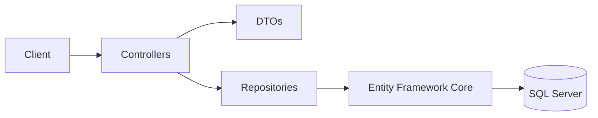

<div align="center">

# Holistic E-Commerce API

### A layered ASP.NET Core API for customers, products, shopping carts, and orders

`ASP.NET Core 8` · `Entity Framework Core` · `SQL Server` · `Repository Pattern` · `DTOs` · `Swagger`

</div>

## Overview

Holistic E-Commerce API models the core workflow of an online store. It separates HTTP endpoints, DTO contracts, repository interfaces, persistence, and domain entities to provide a clear foundation for customer, product, cart, and order operations.

## Capabilities

- Create and retrieve customers.
- Add products to the catalogue.
- Create, list, update, and delete orders.
- Model shopping carts and their relationships.
- Keep API contracts separate from EF Core entities using DTOs.
- Isolate data-access logic behind repository interfaces.
- Explore endpoints through Swagger UI.

## Implemented endpoints

| Method | Endpoint | Purpose |
|---|---|---|
| `POST` | `/api/Customer/AddCustomer` | Create a customer |
| `GET` | `/api/Customer/GetCustomerById/{id}` | Retrieve one customer |
| `POST` | `/api/Product/AddProduct` | Add a product |
| `GET` | `/api/Order` | List orders |
| `POST` | `/api/Order` | Create an order with customer data |
| `PUT` | `/api/Order/{id}` | Update an order |
| `DELETE` | `/api/Order/{id}` | Delete an order |

## Architecture



## Project structure

```text
Holistic_E-Commerce Project/
├── Controllers/       Customer, Product, and Order endpoints
├── Dtos/              Request, response, and update contracts
├── Model/             Customer, Product, Cart, and Order entities
├── Repos/             Repository interfaces and implementations
├── Data/              AppDbContext
├── Migrations/        EF Core schema history
└── Program.cs         Service registration and middleware
```

## Run locally

### Requirements

- .NET 8 SDK
- SQL Server LocalDB or SQL Server
- EF Core CLI

```bash
git clone https://github.com/MostafaMedhat19/Holistic_E-Commerce-Project.git
cd "Holistic_E-Commerce-Project/Holistic_E-Commerce Project"
dotnet restore
dotnet ef database update
dotnet run
```

Update `ConnectionStrings:DefaultConnection` in `appsettings.json` or with User Secrets before applying migrations.

Open `/swagger` on the local URL printed in the terminal to explore the API.

## Next steps

- Complete full product and shopping-cart CRUD endpoints.
- Add authentication and role-based authorization.
- Introduce FluentValidation and consistent problem responses.
- Add unit and integration tests.
- Add pagination, filtering, and stock management.
- Containerize the API and SQL Server with Docker Compose.

## Author

[Mostafa Medhat](https://github.com/MostafaMedhat19)
